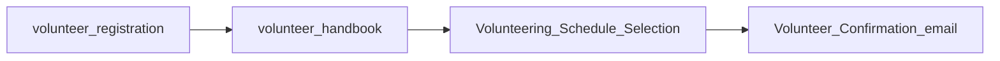

# Volunteer Journey

Path for volunteers registering and selecting schedules through Experience Cloud.

## Flow sequence

## Returning volunteers

Separate menu flows route returning volunteers:

| Flow | Audience |
|------|----------|
| `Return_Volunteer_ONLY_Menu` | Non-riding volunteers |
| `Return_Volunteer_Riding_Menu` | Riding volunteers |
| `ReturningVol` | General returning volunteer paperwork |
| `Returning_Volunteer_Schedule` | Schedule re-selection |
| `Returning_Volunteer_Liability_Waiver` | Liability waiver renewal |

## Key objects

| Object | Role |
|--------|------|
| [[volunteer-info]] | Training dates, roles (horse leader, sidewalker, groomer), emergency contacts |
| `VolunteerWaiver__c` | Waiver and medical form tracking |
| `Volunteer_Schedule__c` | Schedule assignments |
| `Volunteer_Attendance__c` | Class attendance records |
| `Volunteer_Class__c` | Class definitions |

## Confirmation emails

`Volunteer_Confirmation_email` is an after-save **update** flow on `Volunteer_Class__c`. Filter is **Status = Enrolled** with no “status changed to Enrolled” check. It stamps `Contact__c` from the related contact, then sends email alert `Volunteer_Class_confirmation` from org-wide address `angelm@wecanride.org`.

Any save of an already-enrolled volunteer class (Class Management datatable, role edit, contact stamp) re-sends the confirmation. **2026-09-01:** Angel Maltby updated **113** enrolled volunteer classes between 16:00–17:30 CDT (31 created that day, 82 already existed; 53 unique volunteers; mostly Fall classes starting 9/19–9/22). Recipients are the volunteer contacts, not a staff CC.

## Internal vs. external

- External confirmation: `Volunteer_Class_Confirmation_External` flexipage
- Internal application: `Application_Volunteer_Return_Internal` flexipage

## Related

- [[community-access]] — volunteer community permissions
- [[returning-client-paperwork]] — parallel returning paperwork pattern
